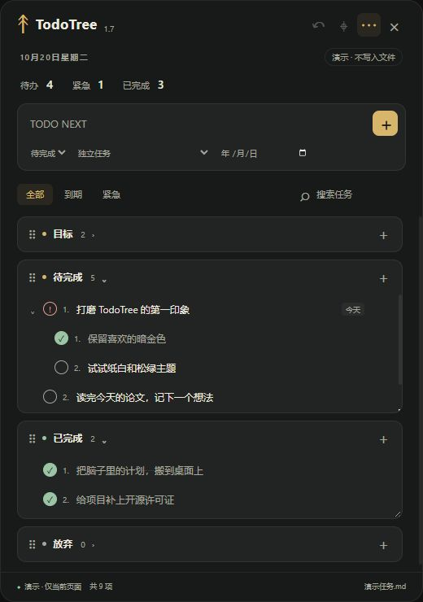
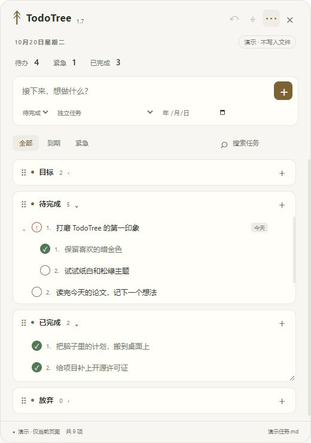
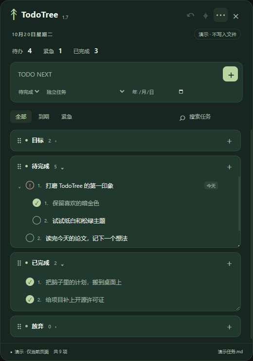

<div align="center">


# TodoTree

**大事化小，琐事上桌。**

*Local-First Markdown Task Tree Pinned to Your Windows Desktop Layer*

[](https://github.com/Infinite-Monkey-Lab/todotree/releases)
[](https://github.com/Infinite-Monkey-Lab/todotree/actions)
[](https://github.com/Infinite-Monkey-Lab/todotree/releases)
[](https://github.com/Infinite-Monkey-Lab/todotree#-markdown-格式与双向同步)
[](LICENSE)

**Win32 桌面层锚定 · 四分区无限任务树 · 纯文本 Markdown 双向同步 · 三套质感主题 · 零云端免注册**

[✨ 为什么选择 TodoTree](#-为什么选择-todotree) · [🎨 主题预览](#-主题与视觉预览) · [🚀 快速开始](#-快速开始) · [⌨️ 交互速查](#️-交互与快捷键速查) · [📄 Markdown 规范](#-markdown-格式与双向同步) · [🛡️ 架构与安全](#️-底层架构与数据安全)

</div>

---

## 🎨 主题与视觉预览

| 🌙 **暗金 (Dark Gold)** | 📄 **纸白 (Paper White)** | 🌲 **松绿 (Forest Green)** |
| :---: | :---: | :---: |
|  |  |  |
| *经典半透明黑金配色，深色极客壁纸绝配* | *温润纸张质感，适配浅色壁纸与日间阅读* | *低饱和自然护眼色调，长时间盯屏不疲劳* |

> 💡 **提示**：上方截图采用演示数据与紧凑视图拍摄。当前最新版本为 **v1.7.0**（安装包名 **Todo**），可直接前往 [**Releases**](https://github.com/Infinite-Monkey-Lab/todotree/releases) 下载开箱即用的 Windows 安装程序。

---

## 💡 为什么选择 TodoTree？

大多数待办工具死于**「看不见」**与**「拆不开」**：
- 藏在浏览器标签页或最小化进托盘的重型 GTD 软件，忙起来一整天都不会点开一次；
- 普通桌面便签要么开启「窗口置顶」遮挡代码和文档，要么按一下 `Win + D`（显示桌面）就跟着所有窗口一起消失；
- 扁平的 Checklist 无法承载周期较长的大目标，任务一多就变成让人焦虑的流水账。

**TodoTree 用三个核心设计解决这些痛点：**

| 维度 | TodoTree | 传统云端待办 (Notion / 滴答等) | 普通桌面便签 (Sticky Notes) |
| :--- | :--- | :--- | :--- |
| **桌面存在感** | **Win32 桌面层锚定**：位于桌面图标之上、普通窗口之下，不挡窗口，**按 `Win + D` 依然稳贴桌面** | 藏在独立窗口或网页里，切走即忘 | 普通窗口或强行置顶，按 `Win + D` 易被最小化 |
| **目标拆解能力** | **四分区（目标/待完成/已完成/放弃）+ 无限子任务树**，跨分区流转依然保留父子溯源 | 多为扁平列表或复杂数据库，拆解阻力大 | 仅支持单层纯文本或简单复选框 |
| **数据主权与生态** | **100% 本地 `.md` 纯文本**，可无缝放入 Obsidian 库、Git 仓库或坚果云/OneDrive，零注册零上传 | 强制注册账号，数据锁死在私有云端格式 | 封闭本地数据库，难以用外部编辑器批量维护 |
| **防丢与并发安全** | **SHA-256 冲突检测 + 临时文件原子替换 + 最近 20 份历史快照自动备份** | 依赖网络同步，离线偶发冲突 | 误删后难以按版本历史回滚 |

---

## ✨ 核心特性

### 📌 1. 原生级桌面层融合 & 浮动双模态
- **真·桌面嵌入**：通过 `koffi` 直接调用 Windows `user32.dll`，将窗口挂载至 `Progman / WorkerW` 桌面容器并压在 `SHELLDLL_DefView` 图标层之上——**免编译 C++ 原生模块**即可实现壁纸级贴合，不抢焦点、不挡工作区。
- **一键双模切换**：点击顶部定位按钮，随时在**「桌面固定模式」**与可自由拖拽标题栏的**「普通浮动窗口」**之间无缝切换。
- **Explorer 重启自愈看门狗**：内置桌面容器存活巡检。当遇到 Windows 资源管理器（`explorer.exe`）重启或特殊显卡/多屏环境导致挂接异常时，自动将窗口无损摘回屏幕并回退为可操作的浮动窗口，绝不出现“幽灵丢窗”。

### 🌳 2. 四分区流转 & 不断链的无限任务树
- **四象限生命周期**：内置 **目标 `[>]`**、**待完成 `[ ]`**（含 **紧急 `[!]`**）、**已完成 `[x]`**、**放弃 `[~]`** 四大核心分区，把长期方向与当下执行清晰剥离。
- **60 秒缓冲自动流转**：点击任务状态圆点可在 `待办 → 完成 → 紧急 → 放弃` 间循环切换。状态变更后提供 **60 秒反悔窗口**（配合最多 **20 步 `Ctrl + Z` 撤回**），倒计时结束后自动归档至对应分区（目标分区常驻不自动流转）。
- **跨区父子关系保持**：当某个子任务率先完成并流转到「已完成」区域后，**依然保留与原父任务的层级绑定并显示来源提示**，保存或重启应用后关系完整还原。
- **DDL 截止提醒与智能检索**：支持为任务绑定截止日期（DDL），按名称实时搜索，或一键筛选**「紧急」**与**「即将到期/已逾期」**任务；紧急任务自动置顶优先展示。

### 🎨 3. 三套主题 & 高自由度视图定制
- **三套精选主题**：内置 **暗金**、**纸白**、**松绿** 三套主题，支持无级调节**背景不透明度**与**任务字号大小**，所有视觉偏好与各分区折叠/高度状态自动持久化记忆。
- **完整视图 vs 紧凑视图**：
  - **完整视图**：顶部展示实时完成度进度条与「待办 / 紧急 / 完成」数量仪表盘（仅统计实际执行任务与子任务，不计入目标与放弃项，且不受搜索筛选干扰）。
  - **紧凑视图**：隐藏顶部概览，将每一寸屏幕空间留给任务树本身。

### 🛡️ 4. 工业级本地文件安全（Local-First）
- **外部编辑器双向协同**：你可以随时用 VS Code、Obsidian 或记事本直接打开并修改任务 `.md` 文件。应用每 **15 秒**巡检外部文件变更：若本地无未保存编辑则静默热同步；若正在输入或有待存改动，则弹出冲突保护提示，支持**先另存副本再载入外部版本**。
- **串行保存队列 + 原子写盘**：高频连续操作按队列严格串行落盘；写入时先生成同目录 `.tmp` 临时文件并二次校验磁盘文件 `SHA-256` 摘要，确认无外部并发篡改后再执行原子替换（`renameSync`），保存失败时明确提示「更改未保存」。
- **20 份滚动时光机备份**：每次落盘自动在应用数据目录的 `backups/<文件名>-<路径摘要>/` 下保存历史快照，每个文件滚动保留最近 **20 份旧版本**，可在设置中一键打开备份目录随时恢复。

---

## 🚀 快速开始

### 方式一：直接安装使用（推荐）

1. 前往 [**GitHub Releases**](https://github.com/Infinite-Monkey-Lab/todotree/releases) 页面下载最新版的 `Todo-Setup-x.x.x.exe` 安装包。
2. 安装并启动应用（应用名称为 **Todo**，沿用紫底对勾图标与既有配置目录）。
3. **数据文件位置**：
   - 默认绑定系统桌面下的 `TODOTREE.md`（**惰性创建**：只有当你首次添加或修改任务时才会真正生成文件，绝不污染桌面）。
   - 你也可以在右上角「设置」中选择任意已有的 `.md` 或 `.txt` 文件（例如放入你的 Obsidian 笔记库或 Git 同步目录中）。

### 方式二：从源码运行（开发者）

建议使用 **Node.js 24 LTS**（已在 Node.js 24 + Windows 11 环境下完成全流程打包与自动化测试验证）。

```bash
# 1. 克隆仓库
git clone https://github.com/Infinite-Monkey-Lab/todotree.git
cd todotree

# 2. 安装精确锁定的依赖
npm ci

# 3. 启动桌面应用
npm start
```

> 💡 **提示**：若 `npm` 提示 Electron 安装脚本需要授权，请按终端提示允许运行构建脚本；Windows 用户也可直接双击仓库根目录下的 `start.bat` 启动。

### 方式三：沙盒演示与浏览器预览

如果你想在不触碰个人真实数据与正式配置的前提下体验主题、测试交互或录制演示视频，项目内置了两种零污染模式：

```bash
# 桌面沙盒演示模式：使用独立临时目录与预置示例任务，默认从浮动窗口启动，不读写正式配置
npm run demo

# 浏览器内存预览模式（需安装 Python 3）：打开 http://127.0.0.1:8765 预览 UI（纯内存演示，不写文件）
npm run preview
```

---

## ⌨️ 交互与快捷键速查

### 全局与窗口快捷键

| 快捷键 / 手势 | 功能说明 |
| :--- | :--- |
| <kbd>Ctrl</kbd> + <kbd>N</kbd> | 立即聚焦顶部「新建任务」输入框 |
| <kbd>Ctrl</kbd> + <kbd>F</kbd> | 展开 / 聚焦任务名称搜索框 |
| <kbd>Ctrl</kbd> + <kbd>Z</kbd> | 撤回上一步操作（非输入框聚焦状态下生效，最多支持 **20 步**历史撤回，也可点左上角撤回按钮） |
| <kbd>Enter</kbd> | 在新建或编辑输入框中确认提交 |
| <kbd>Esc</kbd> | 关闭当前打开的右键菜单、状态菜单或弹窗对话框 |
| **双击任务文本** | 原地进入编辑模式，修改任务名称或截止日期（DDL） |

### 任务树日常操作指南

| 操作场景 | 操作方法 |
| :--- | :--- |
| **添加任务 / 子任务** | 在顶部输入名称后按 <kbd>Enter</kbd> 或点 `+` 号（可指定分区、父任务与截止日期）；也可在任意任务上**右键**或点**行末菜单**直接添加子任务 |
| **状态切换与加急** | 点击任务左侧圆点，依次循环切换：`待办 [ ]` → `完成 [x]` → `紧急 [!]` → `放弃 [~]`；也可通过右键/行末菜单直接指定目标状态 |
| **父子状态联动** | 修改父任务状态会**同步应用至旗下所有子任务**；删除包含子任务的节点前会弹出安全确认 |
| **自由拖拽重排** | 拖动任务行可调整同级排序；将任务直接拖入其他分区标题，可**携整棵子树跨区迁移**；拖动分区左侧手柄可调整四大分区的上下排列顺序 |
| **调整分区布局** | 拖动分区内容区右下角可自由调节该分区的可视高度；点击分区标题栏可一键折叠/展开 |
| **桌面固定 / 浮动** | 点击窗口顶部定位图标，在「嵌入 Windows 桌面层」与「普通浮动窗口（可拖动标题栏）」之间切换 |

---

## 📄 Markdown 格式与双向同步

TodoTree 采用人类可读、兼容主流 Markdown 编辑器的纯文本结构。你可以在任何文本编辑器中直接遵循以下语法编写或维护任务：

```markdown
# Todo

## 目标

- [>] 2026 核心研究方向
  - [>] 完成论文实验与初稿拆解

## 待完成

- [ ] 整理实验基线对比数据 | ddl:2026-12-31
  - [!] 补齐消融实验图表（紧急置顶）

## 已完成

- [x] 搭建本地评测流水线

## 放弃

- [~] 暂不维护旧版兼容脚本
```

<details>
<summary>🔍 <b>展开查看：隐藏元数据注释、非任务内容保留规则与版本回退说明</b></summary>

<br/>

1. **只读打开零侵入**：仅仅打开或查看文件时，TodoTree **绝不会主动重写你的文件**。
2. **隐藏 HTML 注释元数据**：当你首次在应用内对任务进行实际修改并保存时，应用会在任务行末附加隐藏的 `<!-- todotree:... -->` HTML 注释（在 Markdown 预览中不可见），用于持久化记录任务的唯一身份 ID、子树折叠状态、60 秒流转倒计时以及**跨分区的父子映射关系**。同一分区内的父子层级依然由标准的缩进空格决定。
3. **非受管内容安全保留**：
   - 四个标准分区（`## 目标` / `## 待完成` / `## 已完成` / `## 放弃`）之外的自定义标题、段落说明文字与围栏代码块（` ``` `）会被完整保留。
   - **代码块防误导**：围栏代码块内部出现的 `- [ ]` 示例文本不会被误识别或导入为任务。
   - 受管分区内部的说明文字会被保留在该分区的任务列表之后（注：应用保存时会规范化受管分区内的任务排序，不承诺原始手写空行逐字不变）。
4. **旧版本降级兼容提示**：v1.7.0 引入的隐藏注释在旧版应用中可能会被当作普通文字展示。若需回退至旧版应用，请先通过「设置 → 查看自动备份」复制升级前的纯净历史版本。

</details>

---

## 🛠️ 底层架构与数据安全

```text
┌───────────────────────────────────────────────────────────────────────────┐
│                              TodoTree (Electron)                          │
├───────────────────────────┬───────────────────────────┬───────────────────┤
│   Desktop Layer Engine    │     UI & Task Tree        │  Safe File Store  │
│    (desktop-layer.js)     │       (renderer/)         │ (lib/file-store)  │
├───────────────────────────┼───────────────────────────┼───────────────────┤
│ • koffi + Win32 user32    │ • 4-Zone State Machine    │ • SHA-256 Rev ID  │
│ • Progman / WorkerW Hook  │ • Cross-Zone Parent Link  │ • Serial Queue    │
│ • Above SHELLDLL_DefView  │ • 60s Auto-Flow Timer     │ • Atomic .tmp     │
│ • Explorer Crash Watchdog │ • 20-Step Undo Stack      │ • 20x Rolling Bak │
└───────────────────────────┴───────────────────────────┴───────────────────┘
```

### 开发测试与打包构建

项目配备了覆盖核心边界场景的自动化测试套件（包含跨分区深层任务树解析、外部缩进手工编辑、围栏代码块与说明文字保留、高频连续编辑串行保存队列、写入失败与 SHA-256 冲突拦截、20 份备份轮换、配置合并、桌面容器丢失回退及退出前保存拦截共 **26 项自动化测试**）：

```bash
# 运行 Node.js 原生测试套件 (test/*.test.js)
npm test

# 构建 Windows NSIS 安装包（产物输出至 dist/Todo-Setup-1.7.0.exe）
npm run build
```

- **核心技术栈**：Electron 44 · 原生 JavaScript / CSS（零前端框架运行时负担）· Node.js `fs` / `crypto` · `koffi`（Win32 FFI 直调）。
- **已验证矩阵**：520×740 标准视图与 380×500 紧凑小窗布局、Windows 11 NSIS 完整安装与开机自启、主题热切换及多进程并发文件冲突保护。针对多显示器异构 DPI 缩放、睡眠唤醒等极端边缘场景，欢迎通过 Issue 提交设备反馈。

---

## 🗺️ 版本演进 (v1.7.0 重点更新)

- 🎨 **多主题与紧凑视图**：在经典暗金主题基础上新增**纸白**与**松绿**主题，支持透明度、字号调节与完成度概览开关。
- 🔗 **跨区任务树不断链**：子任务完成后流转至其他分区仍保留父任务关联与来源标记，重启后完整恢复。
- 🔍 **高效检索与原地编辑**：新增按名称搜索、紧急/到期筛选、双击原地改名与改日期、行末快捷操作菜单。
- 🛡️ **原子存储与时光机备份**：引入 `SHA-256` 外部修改冲突保护、`.tmp` 临时文件原子替换与每文件 20 份自动滚动备份。
- 🩹 **桌面层看门狗强化**：修复配置互相覆盖及桌面容器重建时的窗口恢复问题，挂接失败自动平稳回退至浮动窗口。

> 📜 完整更新日志请参阅：[docs/CHANGELOG-1.7.md](docs/CHANGELOG-1.7.md)

---

## 📄 开源许可

本项目基于 [MIT License](LICENSE) 开源 · Copyright © 2026 [yunyancuo](https://github.com/yunyancuo) & [Infinite-Monkey-Lab](https://github.com/Infinite-Monkey-Lab)。第三方依赖保留各自原始许可证。

<div align="center">

**如果 TodoTree 让你的桌面更清爽、目标更清晰，欢迎点亮一颗 ⭐ Star 支持我们！**

</div>
