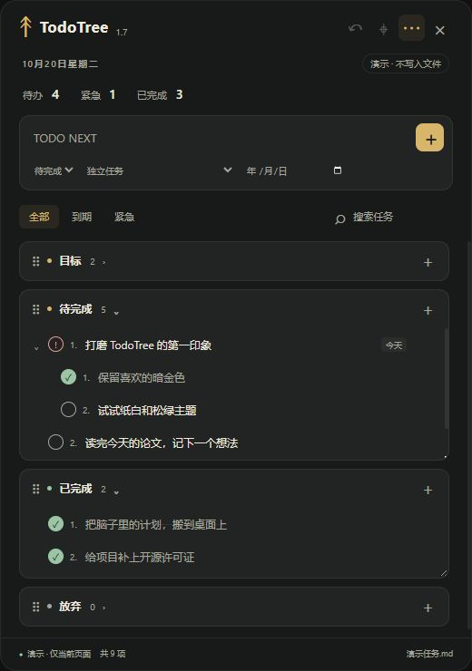
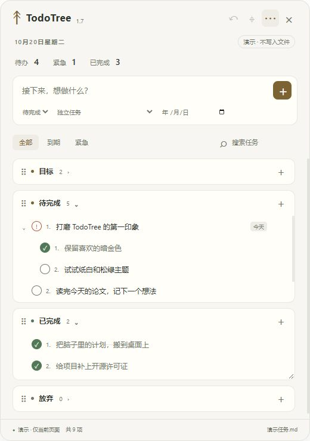
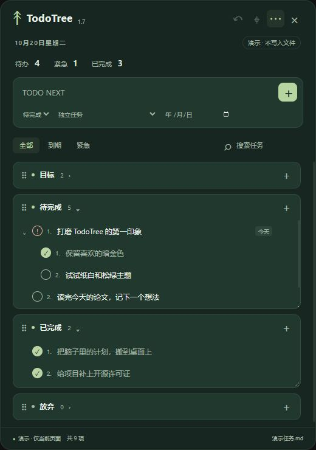

<div align="center">


# TodoTree

**大事化小，琐事化了。**

把目标拆成任务树，放在每天看得见的 Windows 桌面上。

[](https://github.com/Infinite-Monkey-Lab/todotree/releases)
[](https://github.com/Infinite-Monkey-Lab/todotree/actions)
[](https://github.com/Infinite-Monkey-Lab/todotree/releases)
[](LICENSE)

本地 Markdown · 四分区任务树 · 三套主题 · 无需账号

[下载安装](https://github.com/Infinite-Monkey-Lab/todotree/releases) · [快速开始](#快速开始) · [日常操作](#日常操作) · [数据与备份](#数据与备份) · [开发指南](#开发指南)

</div>

## 先看看它的样子

| 暗金 | 纸白 | 松绿 |
| :---: | :---: | :---: |
|  |  |  |
| 深色背景与金色点缀 | 浅色背景，便于阅读 | 低饱和绿色 |

截图使用演示数据与紧凑视图。安装后的应用名称为 **Todo**；本仓库与项目名称为 **TodoTree**。

## 快速开始

1. 从 [Releases](https://github.com/Infinite-Monkey-Lab/todotree/releases) 下载 `Todo-Setup-<版本号>.exe`，安装并启动。
2. 在顶部输入第一条任务，按 <kbd>Enter</kbd> 保存。需要拆解时，右键任务添加子任务。
3. 点击顶部定位按钮，选择桌面固定或普通浮动模式；在设置中调整主题、字号和背景不透明度。

默认任务文件是系统桌面上的 `TODOTREE.md`，首次添加或修改任务时才创建。你也可以在设置中选择已有的 `.md` 或 `.txt` 文件。

> **数据由你保管。** 应用无需注册，也不上传任务。若将文件放进 OneDrive、坚果云或其他同步目录，文件同步由对应软件处理。

## 它能做什么

| 日常需要 | TodoTree 的做法 |
| :--- | :--- |
| 让任务留在视线里 | 固定在 Windows 桌面层，位于普通窗口之下；也可切换为浮动窗口 |
| 把目标拆成下一步 | 目标、待完成、已完成、放弃四个分区，支持多层子任务 |
| 追踪任务去向 | 子任务跨分区流转后保留父任务关联与来源提示 |
| 找到当前重点 | 名称搜索、紧急筛选、到期筛选与截止日期 |
| 调整桌面布局 | 暗金、纸白、松绿主题；字号、不透明度、分区高度和紧凑视图 |
| 用自己的编辑器维护 | Markdown 文件可直接编辑，应用检查外部变化并提示冲突 |
| 找回之前的内容 | 最多 20 步撤回，每个文件保留最近 20 份历史备份 |

桌面固定模式通过 Win32 桌面容器实现。挂接失败或桌面容器丢失时，应用会尝试回退为可操作的浮动窗口；多屏、不同缩放比例等环境的验证范围见[开发指南](#开发指南)。

## 日常操作

### 任务与分区

| 操作 | 方法 |
| :--- | :--- |
| 新建任务 | 顶部输入后按 <kbd>Enter</kbd>，或点击 `+` |
| 添加子任务 | 右键任务，或打开行末菜单 |
| 修改名称与截止日期 | 双击任务文本 |
| 切换状态 | 点击左侧圆点：待办 → 完成 → 紧急 → 放弃；也可从菜单直接选择 |
| 调整任务顺序 | 拖动任务行；拖到其他分区标题可迁移整棵子树 |
| 调整分区布局 | 拖动分区手柄排序，拖动右下角调整高度，点击标题折叠 |
| 切换桌面固定与浮动 | 点击顶部定位图标 |

状态变更后有 **60 秒缓冲**，随后流转到对应分区；目标分区不自动流转。修改父任务状态会同步影响子任务，删除含子任务的节点前会要求确认。

完整视图显示完成度与待办、紧急、完成数量；紧凑视图隐藏顶部概览。统计不包含目标和放弃项，也不受搜索筛选影响。

### 快捷键

| 快捷键 | 功能 |
| :--- | :--- |
| <kbd>Ctrl</kbd> + <kbd>N</kbd> | 聚焦新建任务输入框 |
| <kbd>Ctrl</kbd> + <kbd>F</kbd> | 打开或聚焦搜索 |
| <kbd>Ctrl</kbd> + <kbd>Z</kbd> | 撤回任务操作，最多 20 步；输入框内使用文本编辑行为 |
| <kbd>Enter</kbd> | 确认新建或编辑 |
| <kbd>Esc</kbd> | 关闭当前菜单或对话框 |

## 数据与备份

### Markdown 格式

四个标题对应四个分区，缩进表达同一分区内的父子关系：

```markdown
# Todo

## 目标

- [>] 完成一个开源项目
  - [>] 发布第一个可用版本

## 待完成

- [ ] 整理使用说明 | ddl:2026-12-31
  - [!] 补充安装截图

## 已完成

- [x] 搭建开发环境

## 放弃

- [~] 暂不维护旧版兼容脚本
```

完整模板见 [TODOTREE-template.md](TODOTREE-template.md)。

### 外部编辑与恢复

- **外部编辑**：应用每 15 秒检查文件变化。没有待保存编辑时载入外部版本；存在本地改动或正在输入时提示冲突，可先另存副本。
- **保存保护**：保存请求串行执行，写入临时文件并检查文件摘要，随后替换原文件。失败时显示“更改未保存”。
- **历史备份**：每个文件保留最近 20 份旧版本。在设置中打开备份目录，选择需要的历史文件恢复。

<details>
<summary>格式兼容：隐藏元数据与非任务内容</summary>

仅打开文件不会主动重写内容。首次在应用内修改并保存后，任务行会附加 `<!-- todotree:... -->` 注释，用于记录任务身份、折叠状态、流转计时与跨分区父子关系；Markdown 预览中不显示这些注释。

自定义标题、说明文字和围栏代码块会保留。受管分区内的说明文字放在任务列表之后，任务顺序会规范化，不保证手写空行逐字不变。代码块中的任务示例不会被导入。

v1.7.0 的元数据在旧版应用中可能显示为普通文字。需要降级时，先从“设置 → 查看自动备份”复制升级前的历史版本。

</details>

## 开发指南

### 从源码运行

需要 Windows、Git 与 Node.js。项目现有验证记录使用 Node.js 24 和 Windows 11。

```bash
git clone https://github.com/Infinite-Monkey-Lab/todotree.git
cd todotree
npm ci
npm start
```

### 演示、测试与打包

| 命令 | 用途 |
| :--- | :--- |
| `npm run demo` | 独立临时目录与示例数据，默认浮动窗口，不读写正式配置 |
| `npm run preview` | 浏览器内存预览；需 Python 3，手动打开 `http://127.0.0.1:8765` |
| `npm test` | 运行 Node.js 自动化测试 |
| `npm run build` | 构建 Windows NSIS 安装包，输出到 `dist/` |

浏览器预览用于查看界面与演示交互，不提供 Win32 桌面挂接与真实文件存储。

<details>
<summary>代码结构与验证范围</summary>

| 位置 | 职责 |
| :--- | :--- |
| [desktop-layer.js](desktop-layer.js) | 通过 koffi 调用 Win32，管理桌面挂接与回退 |
| [main.js](main.js)、[preload.js](preload.js) | 应用生命周期、窗口、配置与进程间接口 |
| [renderer/](renderer/) | 界面、任务树与交互 |
| [lib/file-store.js](lib/file-store.js) | 文件摘要、保存与备份 |
| [test/](test/) | 任务解析、文件存储、保存队列与桌面回退测试 |

技术栈为 Electron、原生 JavaScript / CSS 与 koffi，依赖版本以 [package.json](package.json) 和锁文件为准。

[v1.7.0 验证记录](docs/CHANGELOG-1.7.md#验证范围)包含 26 项自动化测试，以及 Windows 11 安装包、启动、主题切换和落盘检查。多屏不同缩放、睡眠唤醒与资源管理器重启尚未完整验证。

</details>

## 更新与反馈

v1.7.0 增加纸白与松绿主题、紧凑视图、名称搜索、到期筛选、跨分区父子关系恢复与自动备份。完整记录见 [更新日志](docs/CHANGELOG-1.7.md)。

遇到问题或有改进建议，欢迎提交 [Issue](https://github.com/Infinite-Monkey-Lab/todotree/issues)。桌面挂接问题请附 Windows 版本、显示器数量与缩放比例，便于复现。

## 许可

项目采用 [MIT License](LICENSE)，第三方依赖遵循各自许可证。

由 [Infinite Monkey Lab](https://github.com/Infinite-Monkey-Lab) 维护。
